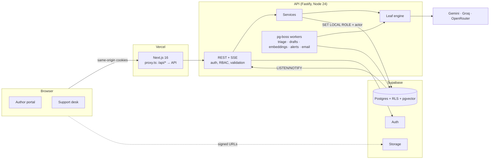

# BookLeaf Author Support & Communication Portal

A support portal for BookLeaf Publishing's authors and the team that looks after them, with **Leaf**, BookLeaf's own
support AI, built into both sides:

- **Authors** see their books, sales and royalties, ask questions, get instant policy-grounded answers from Leaf, and
  follow every conversation live.
- **The BookLeaf team** works one urgency-ranked queue in which Leaf has already triaged each ticket (category,
  priority, a one-line read, manipulation attempts flagged) and drafted a reply grounded in the author's real records
  and BookLeaf policy. The draft is fact-checked live while a specialist edits it.

> **Live demo:** _URL added at deployment_ · **API reference:** `<api-url>/docs`
>
> Everything below also runs locally with **zero external services**; see [Quick start](#quick-start).

## Test credentials

The login page lists every demo persona; one click signs in.

| Who                                | Email                         | Password           | Try                            |
| ---------------------------------- | ----------------------------- | ------------------ | ------------------------------ |
| Support Lead                       | `aarav.mehta@bookleaf.test`   | `BookLeaf@Admin1`  | the queue, overrides, Insights |
| Author Success Specialist          | `isha.verma@bookleaf.test`    | `BookLeaf@Admin1`  | assignment hand-offs           |
| Production Liaison                 | `kabir.rao@bookleaf.test`     | `BookLeaf@Admin1`  | production tickets             |
| Author: never paid in 2 years      | `ananya.reddy@email.com`      | `BookLeaf@Author1` | royalty escalation             |
| Author: 3 books, one in production | `sneha.kulkarni@email.com`    | `BookLeaf@Author1` | production tracker             |
| Author: below payout minimum       | `kavita.deshmukh@email.com`   | `BookLeaf@Author1` | ₹1,000 threshold policy        |
| All other dataset authors          | e.g. `priya.sharma@email.com` | `BookLeaf@Author1` |                                |

The 10 authors and 18 books come straight from the provided dataset. The seed adds 13 realistic tickets (backdated, so
SLA states are real): an Amazon US outage reported by three authors, which raises an incident alert; a launch-day
misprint; a prompt-injection attempt; and resolved history with feedback.

## What's in the box

| Brief requirement                                                                          | Where                                                                                                                                                                                                               |
| ------------------------------------------------------------------------------------------ | ------------------------------------------------------------------------------------------------------------------------------------------------------------------------------------------------------------------- |
| Email/password login, authors see only their own data                                      | Supabase Auth behind the API; Postgres **row-level security** enforces isolation, tested at the database level                                                                                                      |
| My Books: title, ISBN, genre, date, status, MRP, sold, earned, paid, pending               | `/books`, `/books/[id]`, with payout-policy status and a production tracker                                                                                                                                         |
| Submit query: book or "General / Account Level", subject, description, attachments         | `/support/new`, with signed direct-to-storage uploads (JPG/PNG/WebP/PDF, 10 MB)                                                                                                                                     |
| My tickets with status, original query, replies, **real-time** updates                     | `/support`, `/support/[ref]`, live over Server-Sent Events, with a polling fallback                                                                                                                                 |
| Admin queue filterable by status, category, priority, date; urgent and oldest easy to spot | `/desk`: urgency ranking, SLA countdowns, clickable counters, URL-synced filters, `j`/`k` keys                                                                                                                      |
| AI classification (6 categories) and priority (4 levels), overridable                      | Leaf triage plus BookLeaf policy rules; admin overrides are final and never re-overwritten                                                                                                                          |
| AI draft grounded in query and knowledge base, editable, sent to author                    | Streaming drafts with refine presets; live fact checks in the editor                                                                                                                                                |
| Status changes, internal notes, assign to self                                             | Ticket workspace: state machine, notes hidden from authors (separate table, no RLS policy), assignment with conflict detection                                                                                      |
| REST API: naming, auth middleware, RBAC, validation, meaningful errors, docs               | Fastify + Zod; RFC 9457 problem details; OpenAPI 3.1 at `/docs`; [Postman collection](docs/api/bookleaf.postman_collection.json)                                                                                    |
| AI keys in env vars only; graceful degradation; cost awareness                             | Keys live only on the API server. With every provider down, tickets are still created, triage falls back to rules, drafts to policy outlines, and admins reply by hand. Token budgets and per-call cost are tracked |

**Beyond the brief:** Ask Leaf (instant answers for authors before they file a ticket), incident alerts (clusters of
similar tickets and category spikes), an editable, versioned knowledge base, "teach Leaf" from great replies,
Insights (SLA compliance, satisfaction, override rates, draft adoption, token savings, latency), email notifications,
dark mode, and keyboard navigation.

## Quick start

Requires Node.js 24 and pnpm 9 (`corepack enable`).

```bash
pnpm install
cp apps/api/.env.example apps/api/.env      # works as-is: embedded Postgres, local auth, local files
pnpm dev                                    # API on :4000, web on :3000
```

Open http://localhost:3000 and pick a persona. The first start migrates and seeds the embedded database (PGlite, in
`apps/api/.data/`). The interactive API reference is at http://localhost:4000/docs.

To switch Leaf on, add any of `GEMINI_API_KEY`, `GROQ_API_KEY` or `OPENROUTER_API_KEY` to `apps/api/.env` (all have free
tiers). Without keys every AI feature still works on its deterministic fallback, which is how CI runs.

| Command                        | Does                                                                                |
| ------------------------------ | ----------------------------------------------------------------------------------- |
| `pnpm test`                    | Unit and integration tests (the API suite boots the real app on in-memory Postgres) |
| `pnpm e2e`                     | Playwright: both portals end to end, including the live reply                       |
| `pnpm lint` / `pnpm typecheck` | Biome / TypeScript, strict                                                          |
| `pnpm db:reset`                | Drop, migrate and re-seed (stop the API first when using the embedded database)     |
| `pnpm ai:eval`                 | Leaf evaluation suite → `docs/ai-eval-report.md` (needs AI keys)                    |
| `pnpm docs:openapi`            | Regenerate `docs/api/openapi.json` and the Postman collection                       |

## Architecture



- **Monorepo** (pnpm + Turborepo): `apps/web`, `apps/api`, and shared packages: `contracts` (Zod DTOs used by both
  ends), `domain` (pure business rules: royalty windows, SLA, ticket state machine, triage policy), `db` (Drizzle schema,
  migrations, RLS) and `ai` (Leaf).
- **Every query runs as the caller.** Each request opens a transaction that sets the actor and drops to a restricted
  Postgres role, so row-level security is a second, independent wall behind the API's own checks.
- **The API never waits on AI.** Creating a ticket enqueues triage _in the same transaction_ (no ticket without a job,
  no job without a ticket). Workers triage, then prepare a draft, so it is ready before a specialist opens the ticket.
- **Realtime is thin.** A database trigger NOTIFYs on commit; the API fans ids (never content) out over SSE to the
  clients allowed to see them; clients refetch through the REST API, so every byte still passes access checks.

More in [docs/ARCHITECTURE.md](docs/ARCHITECTURE.md).

## Leaf: AI strategy

Leaf is designed as BookLeaf's own colleague, not a generic chatbot. It speaks in BookLeaf's voice, quotes BookLeaf
policy verbatim, uses only the author's real numbers, and says plainly when a person needs to step in.

- **The model never does arithmetic or date math.** The API computes a fact sheet per ticket (sales, earned, paid,
  pending, payout windows missed, next payout date, production stage) and Leaf may only state those facts. Every amount,
  date and ISBN in a draft is checked against it, server-side and again live in the editor.
- **Category-scoped retrieval with a token budget:** only the relevant policy sections, 1 or 2 calibration examples, and
  a windowed thread with a rolling summary. Typical draft context is a fraction of "send the whole knowledge base".
- **"AI proposes, policy decides":** deterministic BookLeaf rules raise priority where policy demands (ISBN errors,
  print defects, live books that can't be bought, missed payout windows) and cap it where the situation is explainable
  (below the ₹1,000 minimum) or manipulated.
- **Prompt-injection defence in depth:** Unicode sanitising, nonce-delimited untrusted blocks, a heuristic detector, an
  optional Prompt Guard classifier, a system-prompt canary, structured outputs only, and an injection-flagged ticket can
  never be escalated to Critical by the AI. PII (bank and card numbers, IDs) is masked before any text leaves the server.
- **Free-tier, multi-provider gateway:** cheapest-sufficient routes (Gemini Flash-Lite for triage, Gemini Flash for
  drafts, Groq and OpenRouter as fallbacks), circuit breakers, client-side rate limits, retries, and failover even
  mid-stream. Every call is logged with tokens, latency and estimated cost.

Details, model choices and costs: [docs/AI.md](docs/AI.md). Evaluation method: [`packages/ai/src/evals`](packages/ai/src/evals).

## API

REST under `/api/v1`: `auth/*`, `me/*` (authors, always scoped to the caller) and `admin/*` (team). Consistent
conventions: RFC 9457 errors with a stable `code` and per-field details; cursor pagination; `Idempotency-Key` on creates;
`ETag`/`If-Match` on admin edits; per-user rate limits; SSE at `/events`. See [docs/API.md](docs/API.md), the live
reference at `/docs`, or import the [Postman collection](docs/api/bookleaf.postman_collection.json).

## Limitations and next steps

- **Free-tier AI quotas** cap throughput (roughly hundreds of drafts per day). The routing table is configuration, and a
  paid model (e.g. Claude Haiku) slots in without code changes.
- **No author self-sign-up or password reset UI.** Supabase Auth supports both; accounts come from BookLeaf's records.
- **Single API instance assumed for rate limiting and the profile cache.** Realtime already works across instances
  (LISTEN/NOTIFY). Scaling out needs a shared rate-limit store such as Redis.
- **Royalty data is a snapshot.** The ledger is read-only here; a production integration would sync from the royalty
  system and record payouts per quarter rather than a single "last payout" date.
- **Email** goes through Resend when a key is set, otherwise to the log. Delivery needs a verified domain.

## Repository layout

```
apps/
  api/        Fastify API: modules/*, jobs, seed, CLIs, integration tests
  web/        Next.js app: (author)/*, desk/*, components, e2e/
packages/
  contracts/  Zod schemas + types shared by web and API
  domain/     BookLeaf rules + the knowledge base + the sample dataset
  db/         Drizzle schema, SQL migrations, row-level security
  ai/         Leaf: gateway, providers, guards, prompts, pipelines, fallbacks, evals
docs/         Architecture, AI, API, security, deployment, write-up, OpenAPI
```

Also in `docs/`: [SECURITY.md](docs/SECURITY.md) · [DEPLOYMENT.md](docs/DEPLOYMENT.md) · [WRITEUP.md](docs/WRITEUP.md) (one page)
